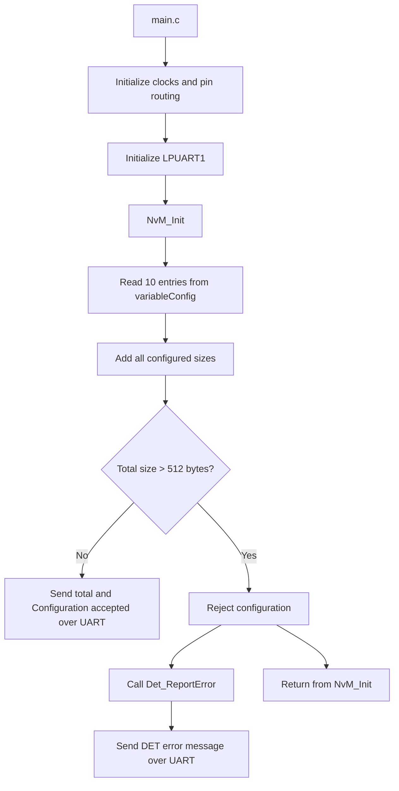

# S32K144 Memory Overflow Detection

## Project overview

This project demonstrates Exercise 3, **Memory Overflow Detection**, from the EEPROM/NvM exercises. The application has a configuration table for 10 variables. `NvM_Init()` adds the configured sizes and checks whether the total fits within the exercise's 512-byte EEPROM capacity.

- A total of **512 bytes or less** is accepted.
- A total **greater than 512 bytes** is rejected and reported through the project's `Det_ReportError()` function.

The current implementation reports messages over UART so they can be viewed in PuTTY.

## Architecture



## Example configuration

The example table in `NVM.c` contains these sizes, in bytes:

```text
2, 4, 20, 8, 16, 32, 10, 12, 6, 24
```

Their total is **134 bytes**, so the current configuration is accepted. The table is declared `static const`, which means these example values are fixed in the firmware. They are not received as runtime input.

## Hardware and software

- MCU/board: NXP S32K144; UART pin mapping below assumes the standard S32K144EVB.
- IDE: S32 Design Studio for S32 Platform.
- UART peripheral: LPUART1.
- UART pins: PTC7 is TX (MCU output); PTC6 is RX (MCU input).
- Serial terminal: PuTTY, configured for the board's virtual COM port at **115200 baud, 8 data bits, no parity, 1 stop bit, no flow control**.

The board's OpenSDA virtual serial connection uses LPUART1 on PTC7/PTC6. Board variants may use different connections; check the board documentation if you are not using the standard S32K144EVB.

## Build and run

1. Open the S32K144 project in S32 Design Studio.
2. Confirm the generated pin configuration routes LPUART1 TX to PTC7 and RX to PTC6, and that LPUART1 is configured for 115200 baud.
3. Build the `Debug_FLASH` configuration.
4. Connect the board using its OpenSDA USB connection and identify its COM port in Windows Device Manager.
5. Open that COM port in PuTTY with the serial settings above.
6. Run the firmware. With the example table, the terminal should show output similar to:

```text
Total configured size: 134 bytes
Configuration accepted
```

## Overflow demonstration

To exercise the error path, temporarily change the first two table entries from `2u` and `4u` to `400u` and `200u`. The total then becomes **728 bytes**, which exceeds the limit. Rebuild and run; the program should report that the configuration was rejected and call `Det_ReportError()`. Restore the original values after the demonstration.

The comparison uses `total_size > MAX_TOTAL_SIZE`, so a total of exactly **512 bytes** is allowed.

## Source files

- `src/main.c` initializes the generated board configuration and LPUART, then calls `NvM_Init()`.
- `src/NVM.c` contains the example size table, total-size check, UART output helper, and demonstration error reporter.
- `src/NVM.h` declares the NvM initialization function.
- `board/` contains generated clock, pin, and peripheral configuration files.
- `*.mex` is the S32 Configuration Tools project configuration.

## Scope and limitations

This project demonstrates the size validation and UART reporting for Exercise 3. It does **not** yet implement actual EEPROM I2C read/write operations or the complete AUTOSAR NvM/Ea stack. The current `Det_ReportError()` is a demonstration function that sends a message over UART; it is not connected to a production AUTOSAR Development Error Tracer service. The table is compile-time configuration, not a set of values parsed from PuTTY.

## Conclusion

This project shows how an NvM initialization routine can validate a configuration before accepting it. It totals the sizes of ten configured variables, accepts totals up to 512 bytes, and reports overflow when the limit is exceeded. The current example totals 134 bytes and is accepted. UART output makes the result visible in PuTTY.
